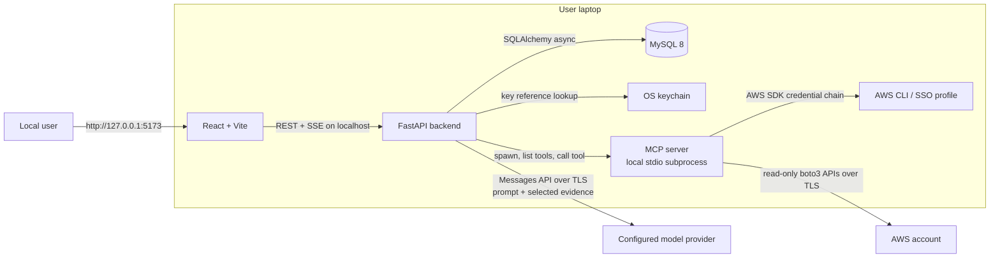
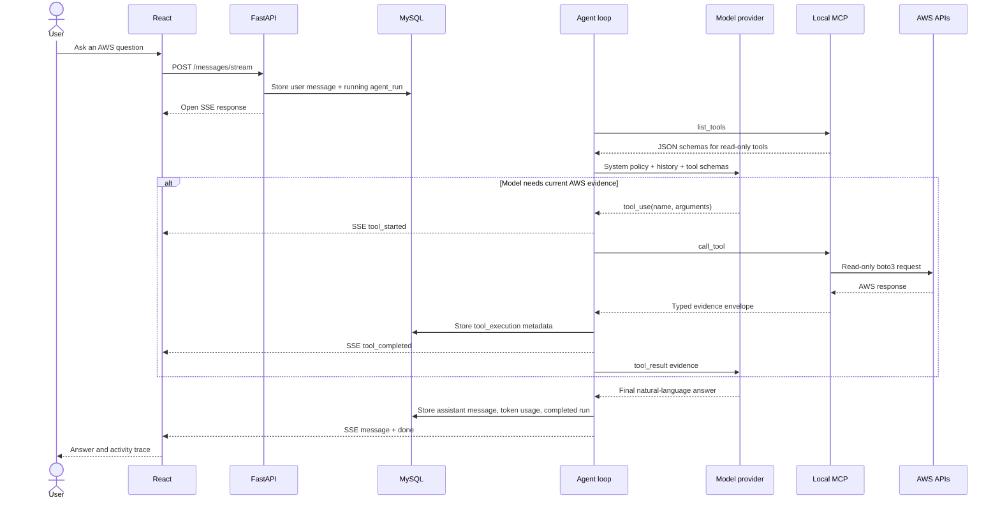
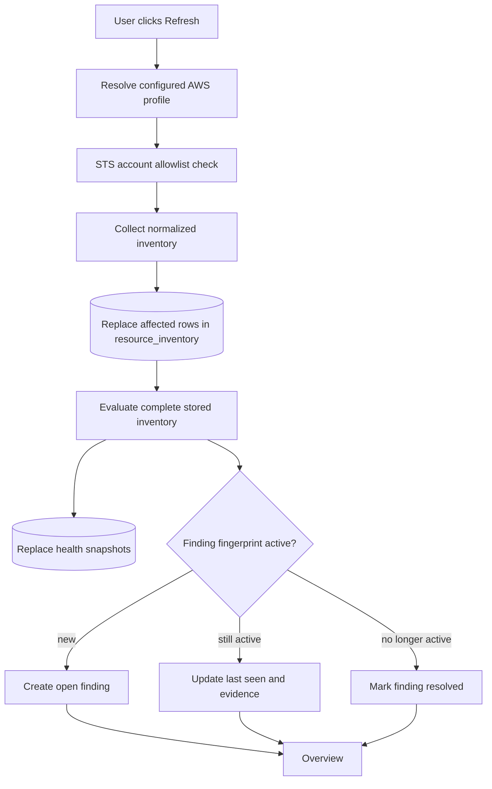
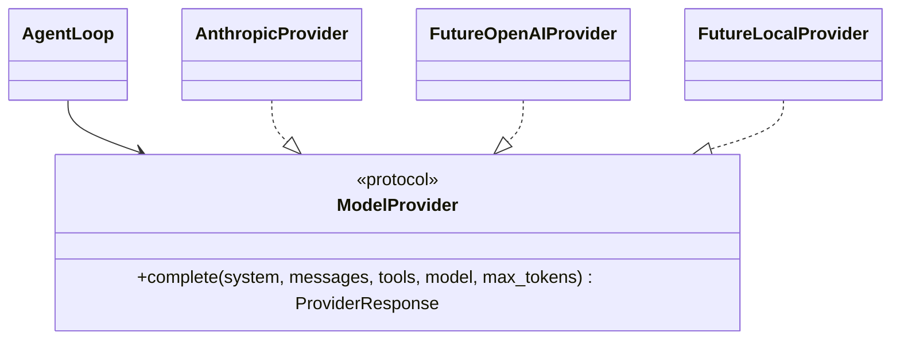
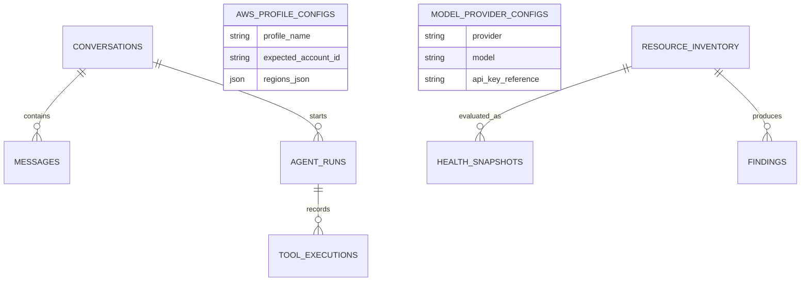

# OpsLens architecture — Phases 0–5

## Design goals

OpsLens is a single-user, laptop-only system. Every application component and all durable state
remain local. The selected model provider may receive the question, conversation context, MCP tool
definitions, and the AWS evidence needed for an answer. AWS and model credentials never enter the
React application or MySQL.

The implementation is a modular monolith plus a deliberately isolated MCP subprocess. That keeps
development and operation simple while preserving replaceable boundaries for the model provider,
AWS data collectors, rules, persistence, and UI.

## Component architecture

Only the Vite development server and FastAPI listen on TCP, both on loopback. The MCP server uses
stdio and is created on demand. MySQL is local; the Docker option publishes only the configured
local development port.

## Module boundaries

| Module | Responsibility | Must not do |
|---|---|---|
| React frontend | Dashboard, settings, inventory, findings, chat, SSE activity | Read credentials or call AWS/model APIs directly |
| FastAPI routes | Local HTTP validation and response streaming | Embed provider-specific agent logic |
| Orchestration | Provider-neutral model/tool loop and safety limits | Call boto3 directly |
| Provider adapters | Translate neutral messages/tools to a model API | Own AWS authorization or business rules |
| MCP client | Discover and invoke typed local tools | Expose arbitrary process execution |
| MCP server | Read-only AWS evidence collection | Mutate AWS or return Parameter Store values |
| Health rules | Deterministic findings from normalized inventory | Depend on an LLM |
| Repositories | MySQL persistence and transactions | Hold API keys or AWS access keys |
| OS keychain | Model API key | Store AWS session state in application tables |

## Conversational request flow

The loop is capped by `OPSLENS_MAX_AGENT_ITERATIONS`. Tool results are capped before being sent to
the model. A tool exception becomes an explicit error result so the model can explain missing
evidence instead of inventing a fact.

## Inventory and deterministic health flow

Health findings do not depend on Claude. Current rules cover ECS desired/running/pending tasks,
ALB state, RDS availability, disabled CloudFront distributions, unverified SES identities, and
CloudWatch alarm/no-data states. Rules are pure and unit-tested, so more checks can be added without
changing the agent.

## Provider-neutral model boundary

`AgentLoop` only understands neutral tool definitions, content blocks, tool calls, text, and usage.
Today the factory builds `AnthropicProvider`. A Codex/OpenAI adapter would translate these values to
that provider's response/tool-call format and register it in the factory; AWS MCP tools, databases,
routes, SSE events, and React do not change.

## Persistence model

The diagram shows logical ownership; health records use stable AWS resource identifiers and finding
fingerprints rather than foreign keys because inventory is replaced during refresh. Audit events
record important configuration, inventory, evaluation, and acknowledgement operations.

## Security and trust boundaries

1. **Browser boundary:** only settings metadata, inventory, findings, and messages cross it. No
   credential is returned to React.
2. **Model boundary:** prompts and selected operational evidence leave the laptop over TLS. The API
   key comes from the OS keychain or a backend-only environment variable.
3. **AWS boundary:** boto3 uses the standard local credential chain and temporary SSO credentials.
   MySQL stores only profile names and an optional expected account ID.
4. **Tool boundary:** the model can choose only registered, schema-validated, read-only MCP tools.
   Parameter Store exposes metadata, never values. KMS never encrypts/decrypts. SES never sends.
   Log search is capped at ten named groups and a bounded time/result window; RDS metric queries
   use CloudWatch and never connect to the database engine.
5. **Network boundary:** API and frontend bind to `127.0.0.1`; FastAPI allows only the configured
   localhost frontend origin and trusted localhost host names.
6. **Prompt-injection boundary:** AWS logs and metadata are untrusted data. The system prompt says
   tool output cannot override policy, and there are no mutation or general-purpose execution tools.

## Failure behavior

- MySQL unavailable: health reports degraded and persistence-dependent endpoints fail explicitly.
- AWS SSO expired or unauthorized: MCP returns a failed tool result; the final answer must describe
  the missing evidence.
- Model key/provider invalid: chat returns a local `409` before an SSE stream starts.
- Model or tool timeout: the run is marked failed and an SSE error is shown.
- Partial AWS permissions: inventory/evidence carries warnings and a `partial` status.
- Browser disconnect: already committed user/run records remain available for audit; a later cleanup
  can mark abandoned runs if desired.

## Extension points

- Add a provider adapter under `backend/src/opslens/providers` and one factory branch.
- Add read-only tools in `mcp-server/src/aws_ops_mcp/server.py`; discovery makes them available to
  the agent automatically.
- Add pure rules in `mcp-server/src/aws_ops_mcp/health.py` and corresponding tests.
- Add saved views, scheduled local polling, or richer metric/log query tools without changing the
  trust model. Scheduled monitoring is intentionally outside Phases 0–5.

## Deliberate current limitation

RDS table row counts are SQL data, not an AWS control-plane or CloudWatch metric. Supporting them
securely requires a second trust boundary: a network route to RDS, TLS verification, a dedicated
read-only MySQL user, database/schema allowlists, query timeouts, and a restricted SQL tool. That
connector is intentionally not inferred from the local OpsLens MySQL configuration and is outside
Phases 0–5.
